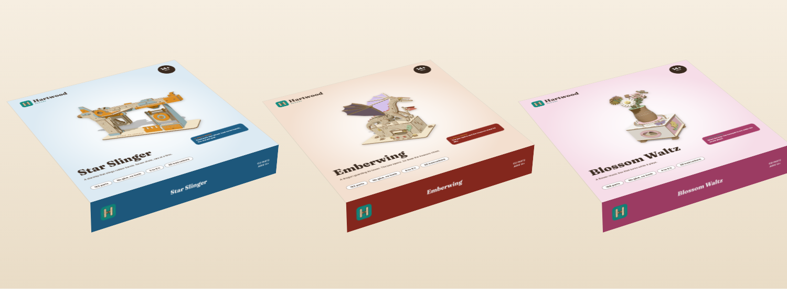
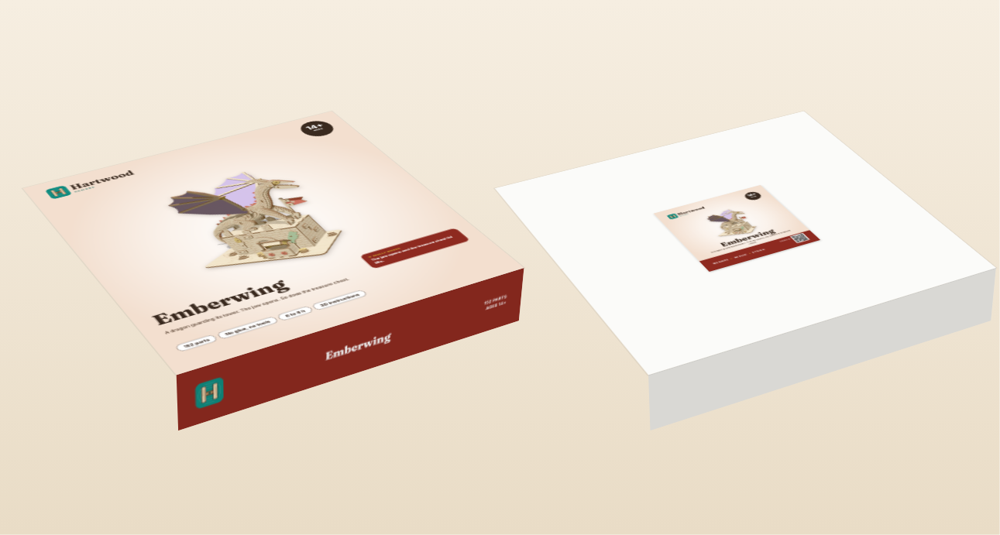

# Packaging

Made by `brand/make_packaging.py` (rerun it after changing a kit, the logo or `SITE_URL`).

## Launch packaging (in the BOM)

A plain white **12 x 12 x 2 in mailer** (Uline S-5817 or similar) with two stickers:

| Sticker | Size | Where | Files |
|---|---|---|---|
| Lid label | 4 x 4 in | Center of the lid | `<kit>_lid_label.pdf` (print, with 0.125 in bleed), `<kit>_lid_label.png` (300 dpi), `<kit>_lid_label_proof.png` |
| Info label | 4 x 2 in | Bottom of the box | `<kit>_info_label.pdf`, `<kit>_info_label_proof.png` |

The info label carries what the Fair Packaging and Labeling Act asks for on a consumer product: what it is, the net contents (by count), and the maker's name and place of business (research S24). It also has the warning, the finished size and an empty **Batch** box. Write the batch code from the planner in it when you pack (SOP-4 step 6).

Cost in the BOM: $0.35 per kit for both labels (Estimate, `supply/bom_per_kit.csv`).

## Phase 2: retail sleeve (optional)

A full-color sleeve that slides over the same mailer, for shops, fairs and wholesale. Files: `<kit>_sleeve.pdf` (print, with bleed), `<kit>_sleeve_proof.png` (trim, safe area and folds), `sleeve_dieline.svg` (cut and fold lines).

Panels, top to bottom on the flat sheet: box top (front of the pack), front edge, box bottom (back of the pack), back edge (printed upside down so it reads right on the box), glue flap. Panel sizes are **Estimates**: measure a real mailer and change `BOX` in `make_packaging.py` before ordering.

## Placeholders to fill (TODO_LUCAS)

- Your city on both labels and the sleeve (`TODO_LUCAS city`).
- Your domain: set `SITE_URL` in `engine/hartwood/config.py`, then rerun this script. The QR codes point to `SITE_URL/build/<kit>` and must be regenerated.
- A UPC barcode on the sleeve (GS1 US), only if a shop or Amazon asks for one.
- Origin line: "Designed and laser cut in Minnesota with imported materials." Do not print an unqualified "Made in USA": the FTC rule needs all or virtually all parts made in the US (research S24). Ask your attorney if you want different wording.
- Blaster: if your attorney says California's imitation-firearm packaging advisory applies, add it to the blaster labels (see `supply/legal_checklist.md`).
