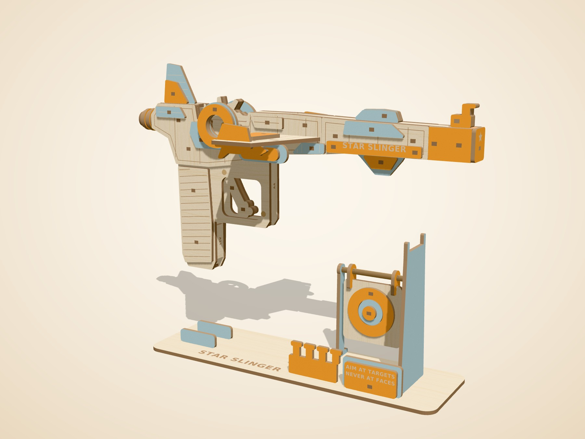

# Blaster test: what to order, cut and check

Build **3 Star Slingers** first. That is enough to find fit problems, test the mechanism, and photograph a finished one. Prices were seen in web search results on 2026-10-12. Open each link to check the current price and stock before you buy.

## 1. Materials for 3 blasters (about $165)

| Item | How many | Why | Direct link | Price seen |
|---|---|---|---|---|
| Natural basswood plywood, 12 x 12 x 1/8 in, 48-pack (ESRICH) | 1 pack | 6 sheets for 3 kits (sheets A and B), plus the fit coupon, speed tests and mistakes | [WoodArtSupply](https://woodartsupply.com/products/48-pack-basswood-sheets-1-8x12x12-inch-unfinished-wood-for-crafts-3mm-basswood-for-laser-cutting-engraving-wood-burining-architectural-models-wood-board-for-painting) | $42.48 |
| Creatorally pre-painted basswood, **Sunset Orange**, 8-pack | 1 pack | Sheet C: the blaze orange nose, cap, plug and trim. 1 sheet makes 2 kits | [Amazon B0G71BWZPY](https://www.amazon.com/dp/B0G71BWZPY) | not shown (about $36, Estimate) |
| Creatorally pre-painted basswood, **Haze Blue**, 8-pack | 1 pack | Sheet D: wings, fins, stand. 1 sheet makes 2 kits | [Amazon B0G6ZSRNMZ](https://www.amazon.com/Creatorally-Pre-Painted-Basswood-Engraving-Ornaments/dp/B0G6ZSRNMZ) | not shown (about $36, Estimate) |
| #64 rubber bands (3.5 x 1/4 in), 1 lb box, about 425 bands | 1 box | The ammo: 12 per kit | [Quill](https://Quill.com/alliance-sterling-multi-purpose-rubber-bands-64-1-lb-box-425-box-24645/cbs/51138144.html) | $16.79 |
| #16 rubber bands, 1 lb box | 1 box | The trigger return spring: 2 per kit | [Staples](https://www.staples.com/alliance-sterling-multi-purpose-rubber-bands-16-1-lb-box-2300-box-24165/product_ALL24165) | $9.49 |
| 3/16 in x 36 in birch dowel | 2 rods | Axle, pivot, band post and target hinge: 110 mm per kit | [Lee Valley](https://www.leevalley.com/en-gb/shop/tools/supplies/joinery/dowel-rods/116661-birch-dowel-rods) or [McMaster-Carr](https://www.mcmaster.com/birch-dowel-rods) | about $0.40 each |
| Paraffin wax block, 1 lb (or any plain candle) | 1 | Waxing the axles so the wheel and trigger turn freely | [Walmart, Gulf Wax](https://www.walmart.com/tp/gulf-wax) | $15.98 |
| Sandpaper, 240 grit | a few sheets | Only if a joint is tight | any hardware store | a few dollars |

The two color sheet sizes match the design: Creatorally lists them as 11.81 x 11.81 in, which is 300 x 300 mm, the exact sheet size in the cut files.

## 2. Laser, safety and tools (skip what you already have)

| Item | Direct link | Price seen |
|---|---|---|
| **OMTech Polar 2, 70W glass tube** (pick the 70W Glass option on the page). LightBurn license included. | [omtech.com](https://omtech.com/products/omtech-polar-2-50w-desktop-rf-co2-laser-engraver-and-cutter) | $3,699.99 (Amazon about $3,515 with a coupon: [Amazon](https://us.amazon.com/OMTech-Polar2-Desktop-Engraver-LightBurn/dp/B0H6HPM59Q)) |
| Window vent kit for a 4 in exhaust hose | [Flamorrow](https://woodartsupply.com/collections/laser-engravers/products/flamorrow-window-vent-kit-with-outdoor-vent-cover-fit-for-3-and-4-hose-adjustable-window-vent-seal-panels-for-exhaust-ventilation-duct-of-laser-engraver-3d-printer-enclosure-dryer-grow-tent) or [Wintcomfort](https://woodartsupply.com/collections/laser-engravers/products/wintcomfort-window-vent-kit-with-louvered-vent-cover-fit-for-3-and-4-vent-hose-adjustable-window-seal-panels-for-3-4-exhaust-ventilation-duct-of-laser-engraver-3d-printer-enclosure-dryer) | $39.99 / $38.99 |
| CO2 fire extinguisher, Amerex 322 (5 lb) | [Tiger Medical](https://tigermedical.com/products/5-lbs-co2-fire-extinguisher-amr322-oo) (Walmart had it at $218) | $247.51 |
| Fire blanket, 1 x 1 m | [Lee Valley](https://www.leevalley.com/en-gb/shop/tools/apparel-and-safety-gear/118404-fire-blanket) | $14.90 |
| Safety glasses, ANSI Z87.1 (for test firing) | [Walmart](https://www.walmart.com/ip/ANSI-Z87-1-Warp-Around-Mens-Shatterproof-Safety-Glasses-U6-S-Yellow-Lens/339425272) | about $7 |
| Digital caliper, 6 in, 0.01 mm (to read the fit coupon) | [SparkFun](https://www.sparkfun.com/6-digital-calipers.html) | $19.95 |
| Distilled water, 1 gallon (for the laser's water loop) | any grocery store, e.g. [Walmart](https://www.walmart.com/ip/Distilled-Water-1-Gallon-Plastic-Bottled-Water-6-Pack/5083299336) | about $1.30 a gallon |

## 3. What to cut

Cut the **fit coupon** first, then the kits. How to load and run each file: [HOW_TO_CUT.md](HOW_TO_CUT.md).

| Order | File | Sheets on the bed | Runs for 3 kits | Gives you |
|---|---|---|---|---|
| 1 | [`kits/coupon/fit_test_coupon.svg`](../kits/coupon/fit_test_coupon.svg) | 1 natural | 1 | Your real kerf and fit (see SOP-5) |
| 2 | [`kits/blaster/cutfiles/blaster_job1_A-B_bed.lbrn2`](../kits/blaster/cutfiles/blaster_job1_A-B_bed.lbrn2) (or `.svg`) | natural (left) + natural (right) | 3 | Sheets A and B for 1 kit per run |
| 3 | [`kits/blaster/cutfiles/blaster_job2_C_x2-D_x2_bed.lbrn2`](../kits/blaster/cutfiles/blaster_job2_C_x2-D_x2_bed.lbrn2) (or `.svg`) | Sunset Orange (left) + Haze Blue (right) | 2 | Sheets C and D for 2 kits per run |

Total: 7 natural, 2 orange and 2 blue sheets. About 10 min per job 1 run and 13 min per job 2 run (Estimate, until you measure your speeds).

## 4. Build and test

1. Pop the parts out (SOP-3). Each part's code is on the part or next to it on the sheet; the parts maps are in [`kits/blaster/parts_map/`](../kits/blaster/parts_map/).
2. Build with the booklet ([`kits/blaster/booklet/blaster_instructions.pdf`](../kits/blaster/booklet/blaster_instructions.pdf)) or the 3D app (Star Slinger, 17 steps).
3. At step 4 and the steps after it, do the **Test it now** checks. Run the full mechanism test plan: [`kits/blaster/mechanism_test_plan.md`](../kits/blaster/mechanism_test_plan.md).
4. **Lift-off test:** lift the ship straight off its stand and drop it back in 10 times. It should seat by itself and not wobble. Note anything that rubs.
5. Log every problem in the planner's Quality tab with the part code. Send me the list and the coupon numbers, and I will update the design.

## 5. What to check on the orange

The nose, plug and cap mark the blaster as a toy (15 CFR 1150). Hold a Sunset Orange sheet next to a blaze orange safety item (a hunting cap or vest) in daylight. If it looks clearly duller or redder, tell me: we can switch sheet C to a blaze orange source.
