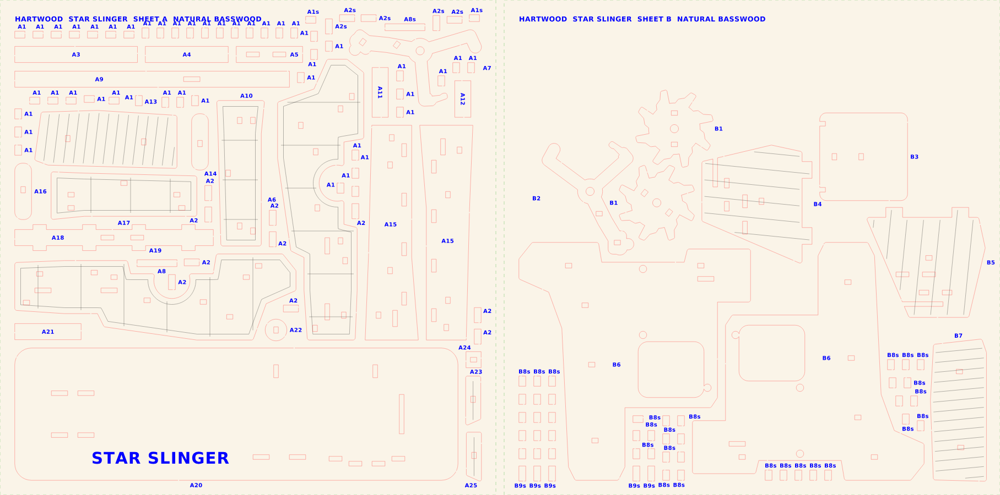

# How to cut a kit on the laser

This guide takes you from a file in this project to cut parts in your hand, using **LightBurn** (it comes with the OMTech Polar 2). The short station version is SOP-2 ([`production/sops/SOP-2_load_and_cut.pdf`](../production/sops/SOP-2_load_and_cut.pdf)). The speeds and powers below are planning numbers (Estimate) until you cut the fit coupon and a material test.

## The files

Every kit has a `cutfiles` folder, for example [`kits/blaster/cutfiles/`](../kits/blaster/cutfiles/).

| File | What it is | Use it for |
|---|---|---|
| `<kit>_job1_A-B_bed.lbrn2` | A LightBurn project with **two sheets side by side** (A left, B right, 5 mm apart) and the settings filled in | Normal production: one job = two sheets |
| `<kit>_job1_A-B_bed.svg` | The same job as a drawing | If the `.lbrn2` will not open |
| `<kit>_sheet_A_natural.lbrn2` / `.svg` / `.dxf` | One sheet on its own | Recutting a single sheet |
| `..._x2_full` / `..._x4_full` | A color sheet with 2 or 4 copies (half or quarter tiles) | Color sheets: one sheet serves 2 or 4 kits |

Colors in every file: **red = cut through**, **blue fill = engrave** (part codes, text), **black thin line = score** (surface lines), **green = the sheet edge** (never cut, only for lining up).

## One-time setup

1. Set up the laser with the OMTech manual: water loop filled with distilled water, exhaust hose out of a window, room above 10 °C (50 °F).
2. Install LightBurn on your computer from lightburnsoftware.com and enter the license key that came with the laser.
3. Connect the laser by USB (or network), then in LightBurn use **Devices > Find My Laser**. Follow OMTech's instructions for the Polar 2 device profile and camera.
4. Calibrate the camera once (LightBurn: **Laser Tools > Calibrate Camera Lens**, then **Align Camera**), so the camera picture lines up with where the laser fires.
5. Cut the **fit coupon**: [`kits/coupon/fit_test_coupon.svg`](../kits/coupon/fit_test_coupon.svg) on one natural sheet. Measure it with the caliper and follow SOP-5. Then run **Laser Tools > Material Test** on a scrap to find the cleanest cut speed and power for your wood.

## Every job

### 1. Open the file

- **Try the project first:** File > Open > [`kits/blaster/cutfiles/blaster_job1_A-B_bed.lbrn2`](../kits/blaster/cutfiles/blaster_job1_A-B_bed.lbrn2). The layers, speeds and order are already set.
- I wrote these `.lbrn2` files with my own code and could not test them in LightBurn. If one does not open, looks empty, or the text on the stand ("STAR SLINGER") reads backwards, close it and **import the SVG** instead (File > Import > the `.svg` with the same name).
- After an SVG import, check the size in the toolbar: a two-sheet bed file is **605 x 300 mm**, a one-sheet file is **300 x 300 mm**.

### 2. Check the layers (Cuts / Layers window)

Set them like this if you imported the SVG. With the `.lbrn2` they should already match:

| Run order | Layer color | What it does | Mode | Speed | Power |
|---|---|---|---|---|---|
| 1st | Blue | Engrave part codes and text | Fill, line interval 0.1 mm | 400 mm/s | 20% |
| 2nd | Black | Score surface lines | Line | 300 mm/s | 18% |
| 3rd (last) | Red | Cut through 3 mm basswood | Line | 30 mm/s | 65% |
| never | Green | Sheet edge, for lining up | Output **off** | - | - |

The run order is the order of the layers in the list, top to bottom: use the up and down arrows so **blue is on top and red is at the bottom**. Cutting last keeps every part in place while it is engraved.

Then open **Edit > Optimization Settings** and tick **Order by layer** and **Cut inner shapes first**. Holes are then cut before the outline around them, so small parts never drop out early.

Once your coupon and material test give better numbers, change the layers and save the job (File > Save). LightBurn writes its own `.lbrn2` file, which you can reuse every time.

### 3. Load the sheets and line up the job

1. Put a straight scrap strip along the top and left edges of the bed as a corner stop (tape or pins).
2. Lay the left sheet in the corner. Lay the right sheet next to it with a 5 mm gap (a scrap of 3 mm ply plus a bit of slack works as a spacer).
3. Sheet letters: the file name tells you which sheet goes where. `job1_A-B` = sheet A left, sheet B right (both natural). `job2_C_x2-D_x2` = Sunset Orange left, Haze Blue right.
4. In LightBurn, click **Update Overlay** in the Camera window. Drag the whole job so the **green outlines sit on the real sheets** in the camera picture.
5. In the Laser window, set **Start From: Absolute Coords**.
6. Set the material height to **3 mm** and let the Polar 2 autofocus (or focus by hand for 3 mm).
7. Click **Frame**. The red dot traces the job. It must stay inside both sheets, about 8 mm from every edge.

### 4. Cut

1. Close the lid. Check that the exhaust and air assist are running.
2. Click **Start**. **Stay at the laser for the whole job** (SOP-6 if a flame does not go out).
3. When it finishes, wait 30 seconds for the smoke to clear.
4. Before you lift the sheets, press a small part near each corner. If one is still stuck, close the lid, turn off the blue and black layers, and run the red layer once more, without moving anything.
5. Unload and check with SOP-3.

## Where to find each part

- Every part has a code engraved on it or next to it on the sheet (for example A7).
- The parts maps show every sheet with its codes: [`kits/blaster/parts_map/sheet_A.png`](../kits/blaster/parts_map/sheet_A.png) to `sheet_D.png`.
- The booklet and the 3D app show which codes you need at each step.

## If something goes wrong

| What you see | What to try |
|---|---|
| Parts still stuck after the cut | Clean the lens, check focus, raise cut power 5% or slow to 25 mm/s |
| Parts fall out of the sheet by themselves | Lower cut power 5%, or set a wider bridge (`BRIDGE` in [`engine/hartwood/config.py`](../engine/hartwood/config.py)) and rebuild |
| Joints too tight or too loose | Cut the coupon, set `KERF` in `config.py`, run `bash tools/rebuild_all.sh` |
| Dark burn marks | Air assist on, faster speed, clean honeycomb |
| Text or engraving reads backwards | Use the SVG instead of the `.lbrn2`, and tell me |
