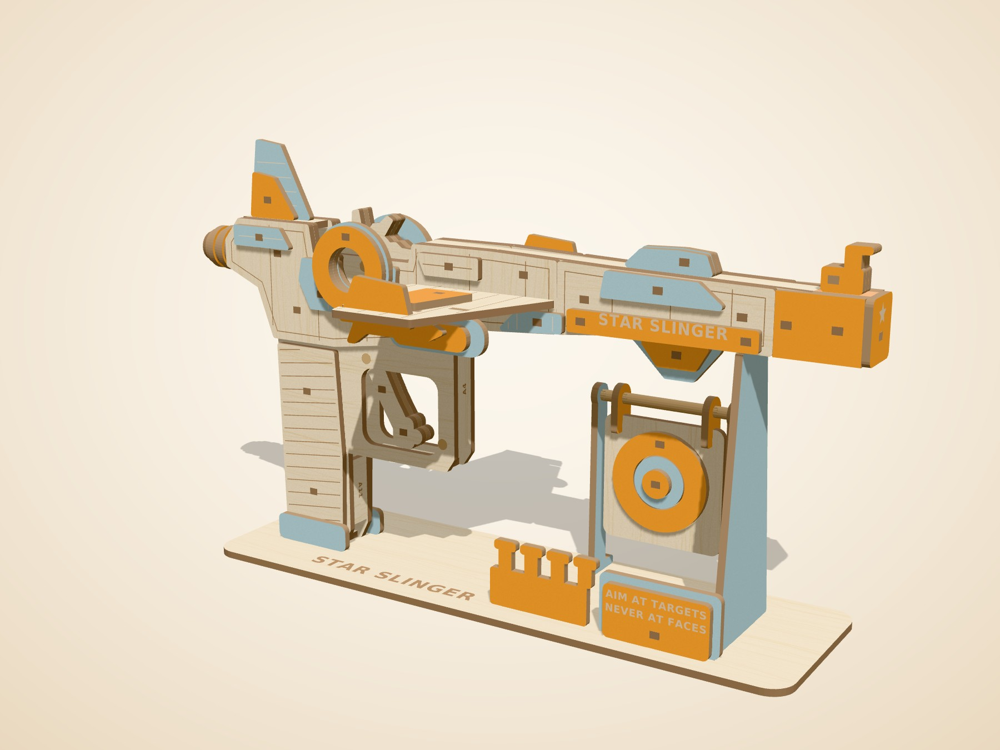
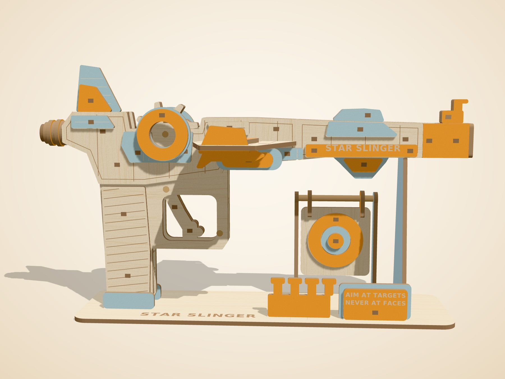
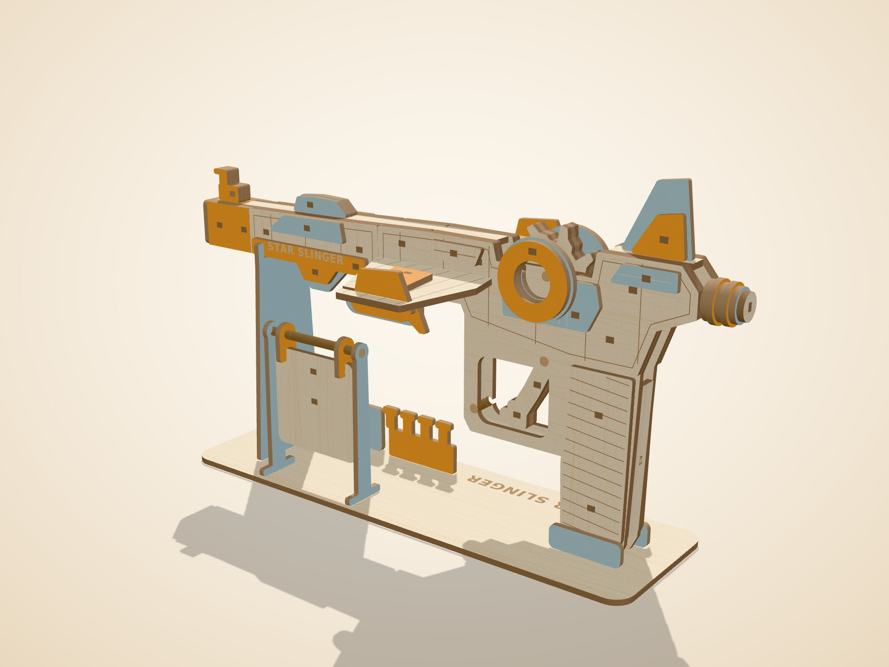
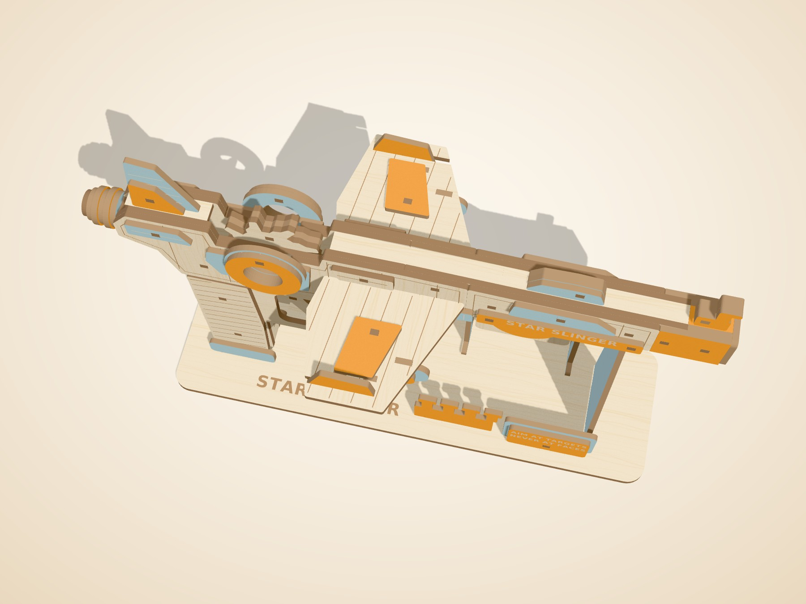
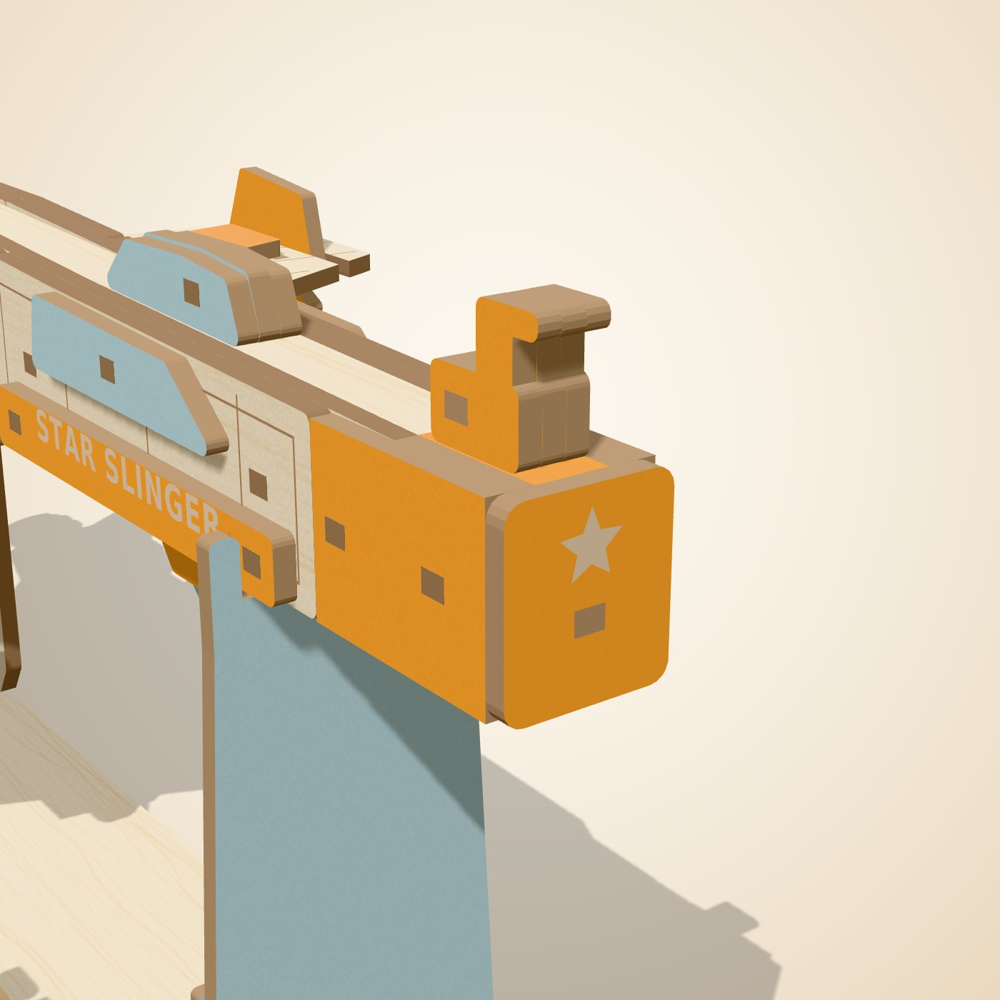
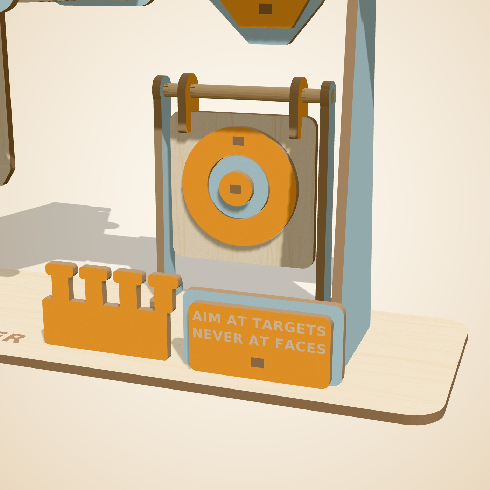
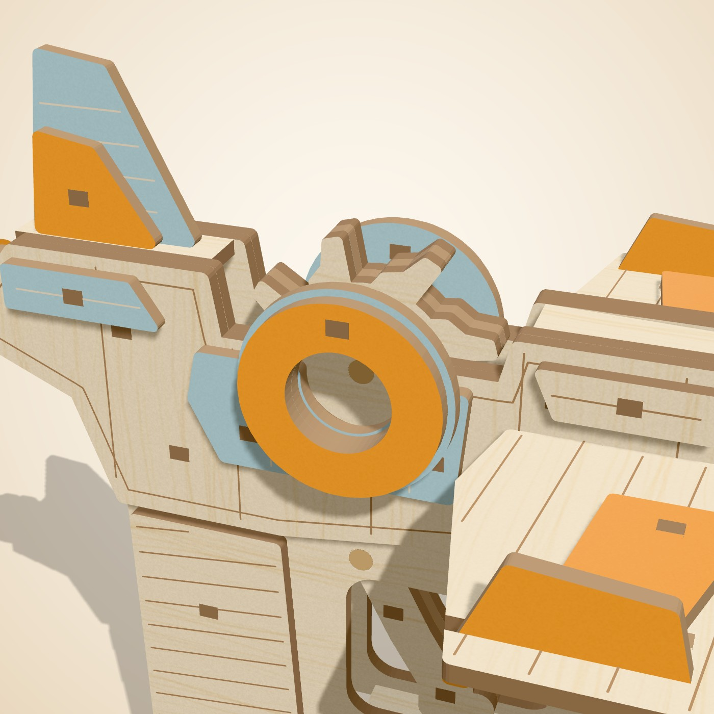

# Star Slinger

_A starship that slings rubber bands. Seven shots, one at a time._

The Star Slinger is a little starfighter with a big secret: a clockwork star wheel in its engine. Load up to seven rubber bands, aim at a paper target, and each pull of the trigger lets exactly one band fly. Its blaze orange nose is built into the ship, so it always looks like what it is: a toy. Build the mechanism, test it at each step, then show it off on its launch stand.

## At a glance

| Item | Value |
|---|---|
| Pieces (wood) | 153 (91 different shapes) |
| Build steps | 17 |
| Difficulty | 4 of 5, about 5 to 6 h |
| Sheets | 4 cut sheets = 3.0 full 12 x 12 in sheet equivalents (2 natural, 1 orange, 1 teal) |
| Laser time per kit | 16.5 min cutting + 1.1 min sheet swaps = **17.6 min** (Estimate, planning speeds) |
| Wood cost per kit | **$6.34** (Estimate, sheet prices in `engine/hartwood/config.py`) |
| Target price | $49.99 |
| Extras in the box | #64 rubber bands (3.5 x 1/4 in), ammo x12; #16 rubber band, trigger return x2; 3/16 in birch dowel, 15.6 mm x3; wax stick x1; sandpaper 240 grit x1; paper targets (printed) x3; 3/16 in birch dowel, 63 mm (target hinge) x1 |

## Design checks

| Check | Result |
|---|---|
| Collision check | PASS: zero overlaps |
| Nothing-floats check | PASS: every part touches another; model is one piece |
| Assembly path check | PASS: every part slides into place without hitting a placed part |
| Minimum feature check | PASS: every part is one piece; no feature thinner than 2.5 mm |
| Pop-out check | PASS: 210 parts held by 353 bridges of 0.5 mm, none on a mating edge or a weak spot, holes cut first, nothing nested in a hole (16 bridges with a note, see warnings) |

Fragile-part report: 45 small or thin parts, each cut with a spare: cockpit_side_l_peg, cockpit_side_r_peg, engine_panel_l_peg, engine_panel_r_peg, grip_l_peg, grip_r_peg, intake_l_peg, intake_r_peg, nose_cap_peg, panel_l0_peg, panel_l1_peg, panel_r0_peg, panel_r1_peg, reactor_l0_peg, reactor_l1_peg, reactor_r0_peg, reactor_r1_peg, safety_peg, skin_front_l_peg, skin_front_r_peg, skin_nose_l_peg, skin_nose_r_peg, skin_rear_l_peg, skin_rear_r_peg, stripe_l_peg, stripe_r_peg, target_ring0_peg, wing_stripe_l_peg, wing_stripe_r_peg.

Mechanism parts marked **needs physical test**: A2, A7, B1, B2, B3, C21, C3, D19.
See [mechanism_test_plan.md](mechanism_test_plan.md).

## Sheets

| Sheet | Color | Size | Parts | Spares | Used | Laser min |
|---|---|---|---|---|---|---|
| A | natural | full | 78 | 8 | 61.7% | 6.4 |
| B | natural | full | 9 | 47 | 40.6% | 3.6 |
| C | orange | half | 38 | 2 | 36.6% | 3.6 |
| D | teal | half | 28 | 0 | 42.1% | 2.8 |

Half and quarter tiles are cut 2 or 4 at a time on one 12 x 12 sheet (files ending `_x2_full` or `_x4_full`).

## Files

- `cutfiles/`: one SVG, DXF and LightBurn file per sheet, plus `*_job*_bed` files that put two sheets on the 710 x 360 mm bed.
- `parts_map/`: a picture of each sheet with every part code (for the booklet and for packing).
- `parts/`: one picture per part code (91 images).
- `blaster.glb`: the 3D model for the instruction app (one node per part).
- `blaster_steps.json`: steps, parts per step, tips and tests.
- `blaster_report.json`: the full build report.

## Renders

