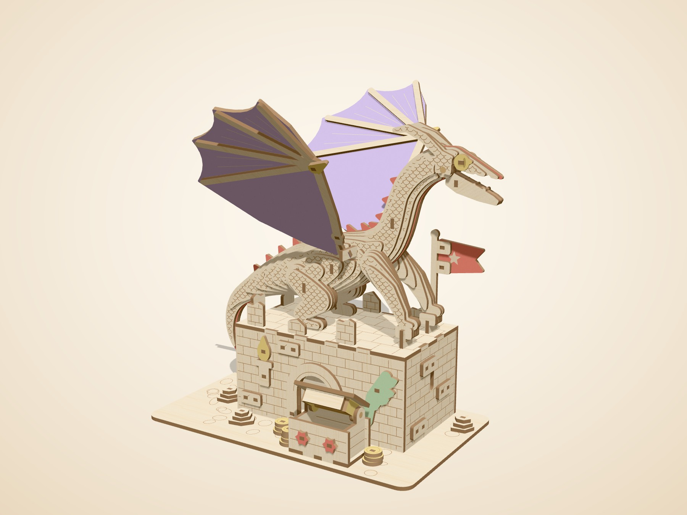
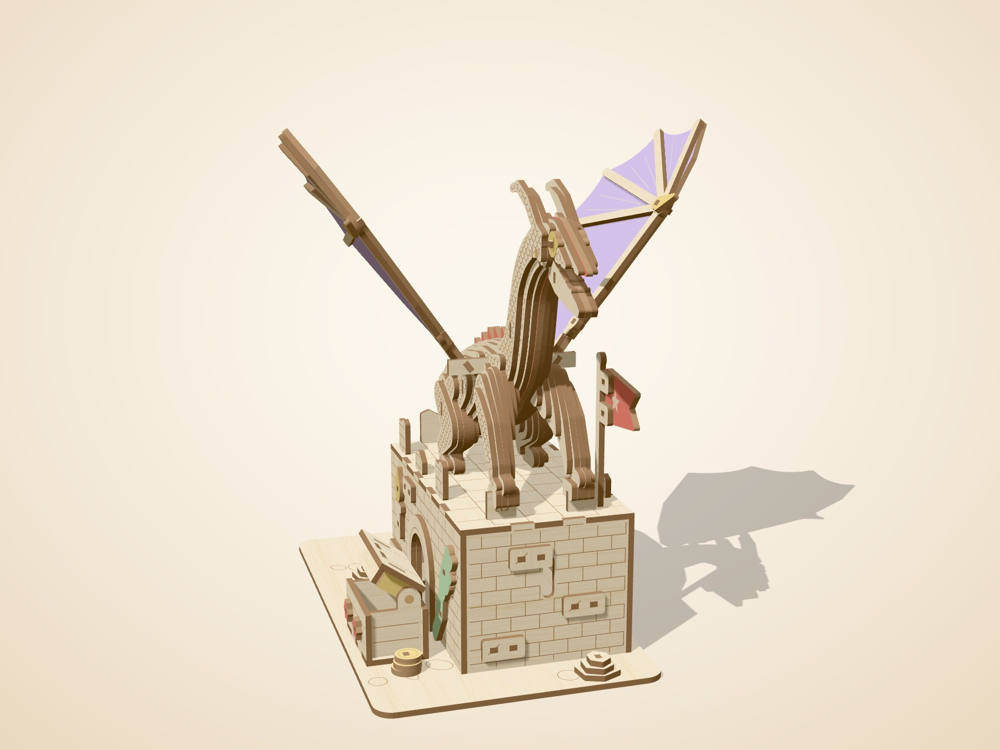
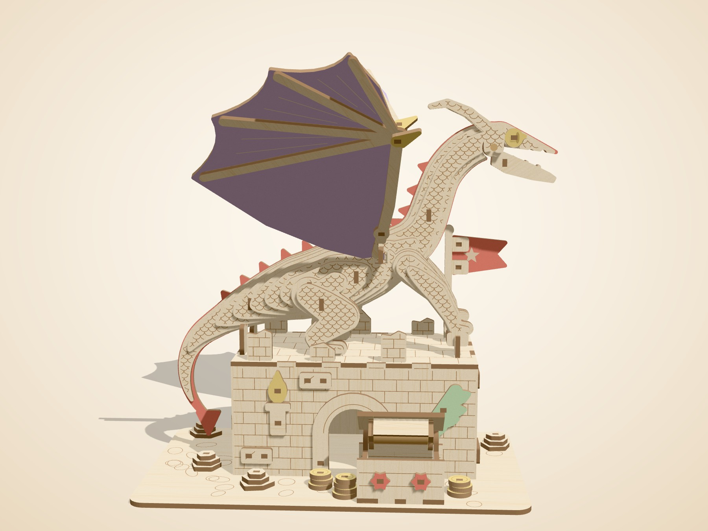
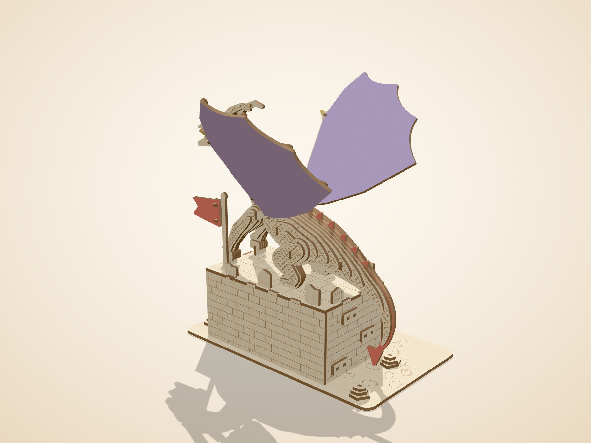
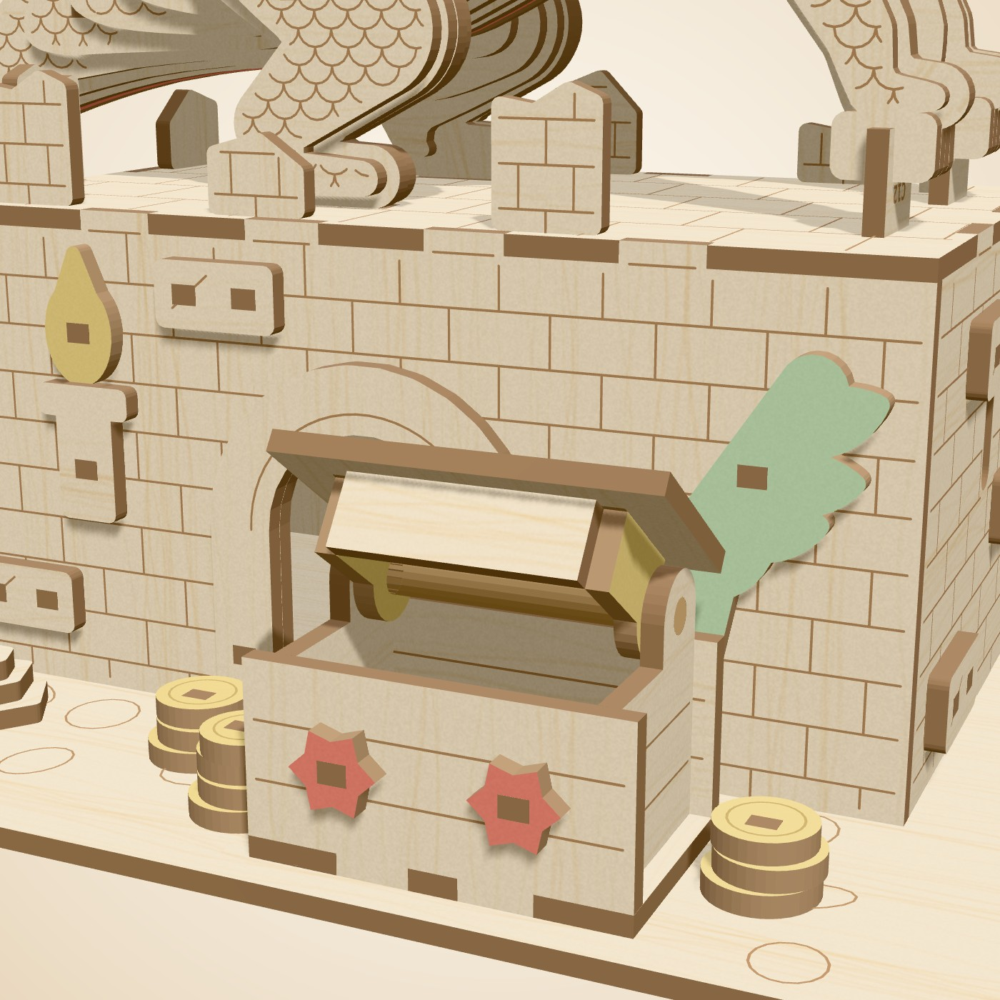
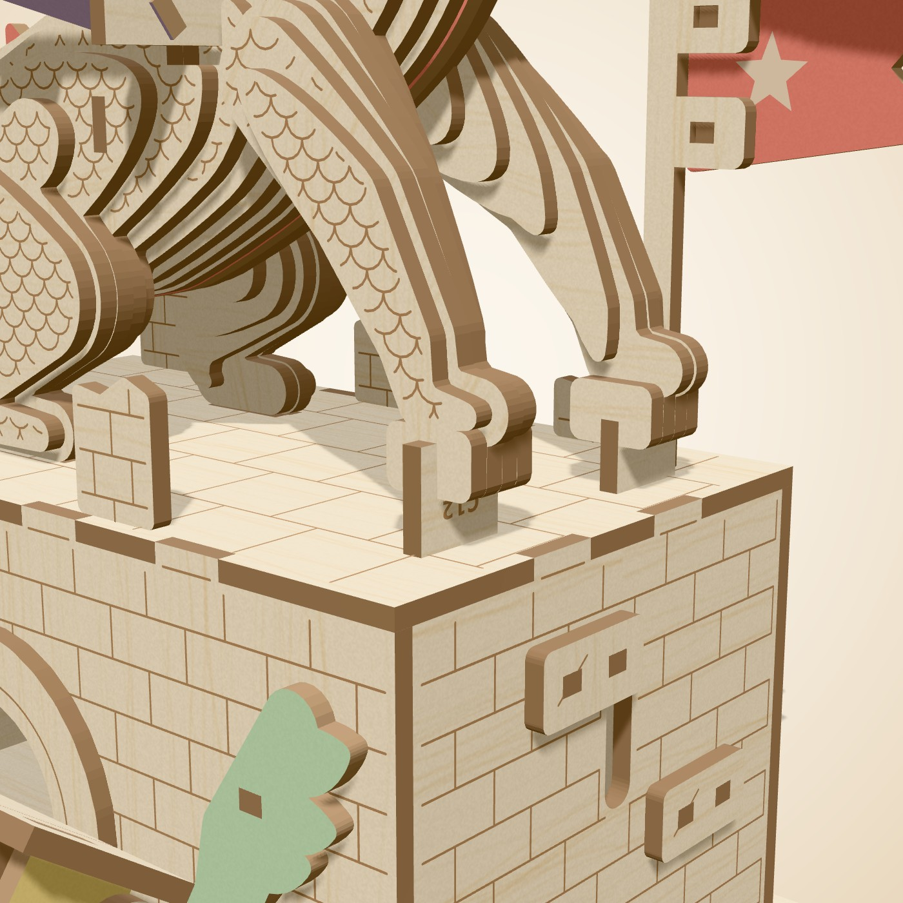
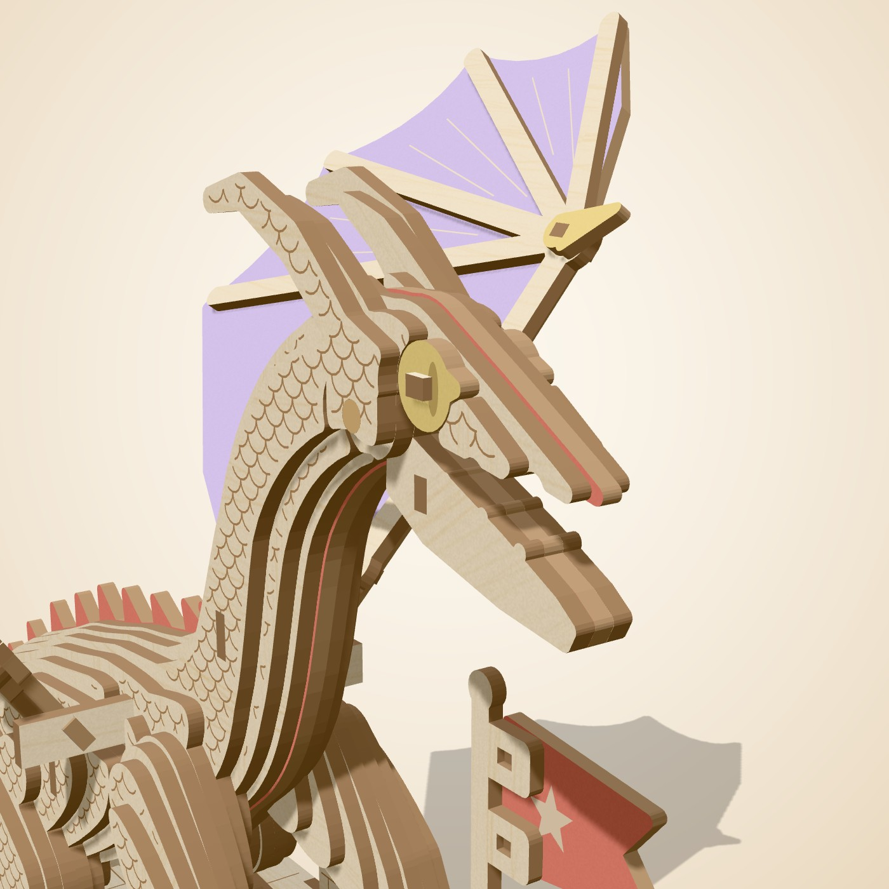

# Emberwing

_A dragon guarding its tower. The jaw opens. So does the treasure chest._

High on a broken tower, Emberwing keeps watch over a chest of gold. Her wings are spread, her claws lock onto the stone, and her jaw opens in a silent roar. Every slice of her body is a 3 mm layer, stacked on hidden keys, with scales drawn by the laser. Lift the lid of the chest to check the gold is still there.

## At a glance

| Item | Value |
|---|---|
| Pieces (wood) | 152 (105 different shapes) |
| Build steps | 21 |
| Difficulty | 4 of 5, about 6 to 8 h |
| Sheets | 8 cut sheets = 6.0 full 12 x 12 in sheet equivalents (1 gold, 1 green, 4 natural, 1 purple, 1 red) |
| Laser time per kit | 22.4 min cutting + 2.2 min sheet swaps = **24.6 min** (Estimate, planning speeds) |
| Wood cost per kit | **$12.60** (Estimate, sheet prices in `engine/hartwood/config.py`) |
| Target price | $54.99 |
| Extras in the box | 3/16 in birch dowel, 21 mm (jaw) x1; 3/16 in birch dowel, 56 mm (chest hinge) x1; sandpaper 240 grit x1 |

## Design checks

| Check | Result |
|---|---|
| Collision check | PASS: zero overlaps |
| Nothing-floats check | PASS: every part touches another; model is one piece |
| Assembly path check | PASS: every part slides into place without hitting a placed part |
| Minimum feature check | PASS: no feature thinner than 2.5 mm |

Fragile-part report: 4 small or thin parts, each cut with a spare: banner_peg, wing_l_peg, wing_r_peg.

Mechanism parts marked **needs physical test**: A16, A19, A20, A24, B28, D3, F7.

## Sheets

| Sheet | Color | Size | Parts | Spares | Used | Laser min |
|---|---|---|---|---|---|---|
| A | natural | full | 38 | 0 | 68.6% | 4.9 |
| B | natural | full | 61 | 4 | 52.4% | 6.9 |
| C | natural | full | 24 | 2 | 50.5% | 5.0 |
| D | red | full | 5 | 0 | 11.9% | 1.2 |
| E | natural | full | 4 | 0 | 37.7% | 2.7 |
| F | gold | quarter | 17 | 0 | 11.1% | 0.9 |
| G | purple | half | 2 | 0 | 53.6% | 0.7 |
| H | green | quarter | 1 | 0 | 3.6% | 0.2 |

Half and quarter tiles are cut 2 or 4 at a time on one 12 x 12 sheet (files ending `_x2_full` or `_x4_full`).

## Files

- `cutfiles/`: one SVG, DXF and LightBurn file per sheet, plus `*_job*_bed` files that put two sheets on the 710 x 360 mm bed.
- `parts_map/`: a picture of each sheet with every part code (for the booklet and for packing).
- `parts/`: one picture per part code (105 images).
- `dragon.glb`: the 3D model for the instruction app (one node per part).
- `dragon_steps.json`: steps, parts per step, tips and tests.
- `dragon_report.json`: the full build report.

## Renders

