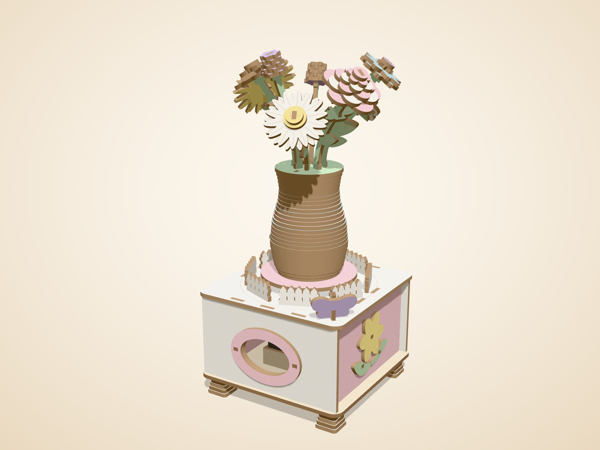
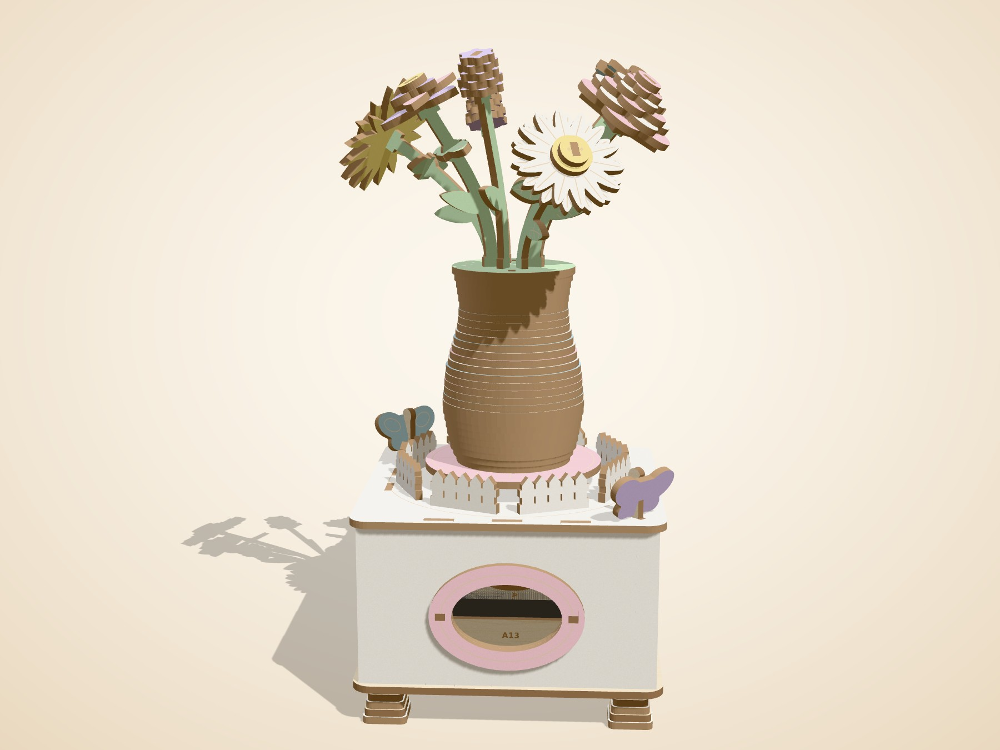
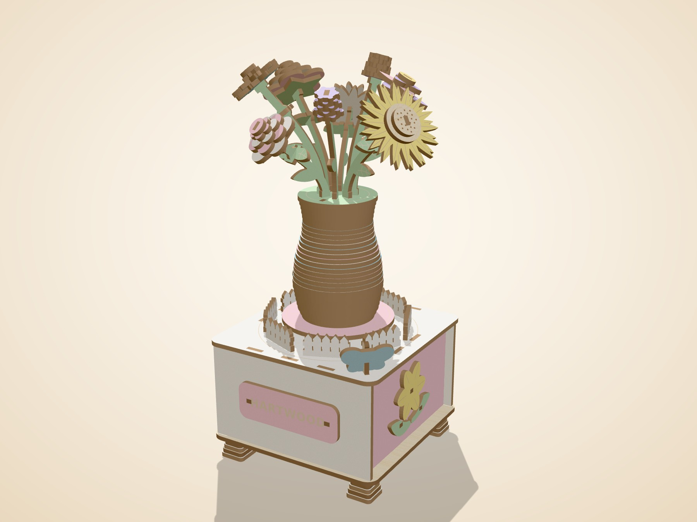
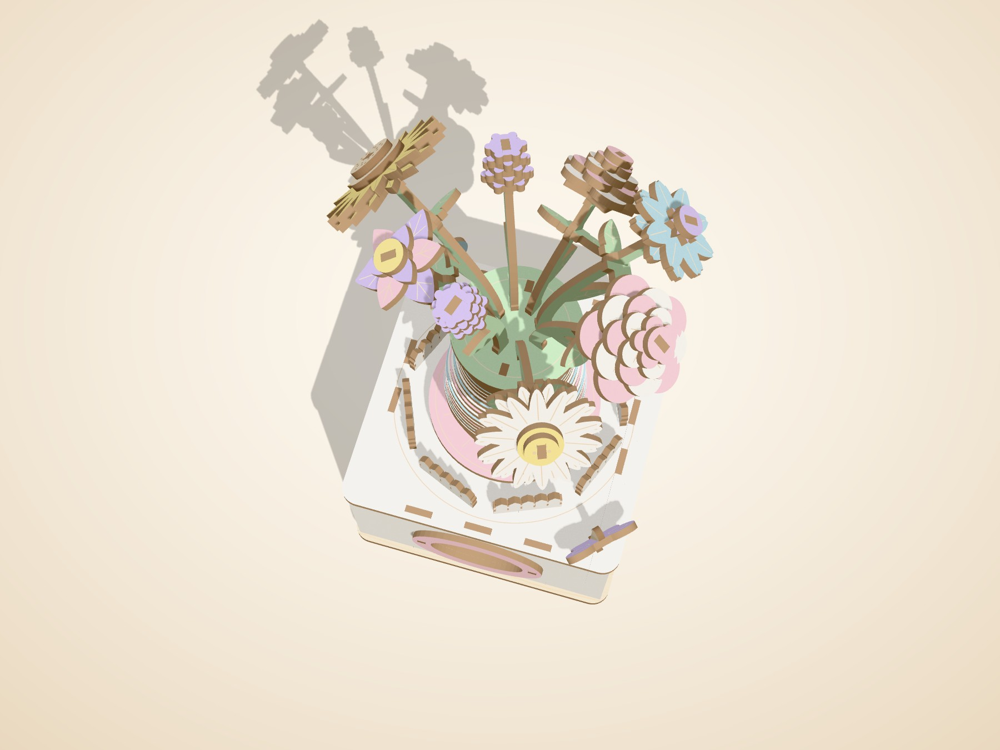
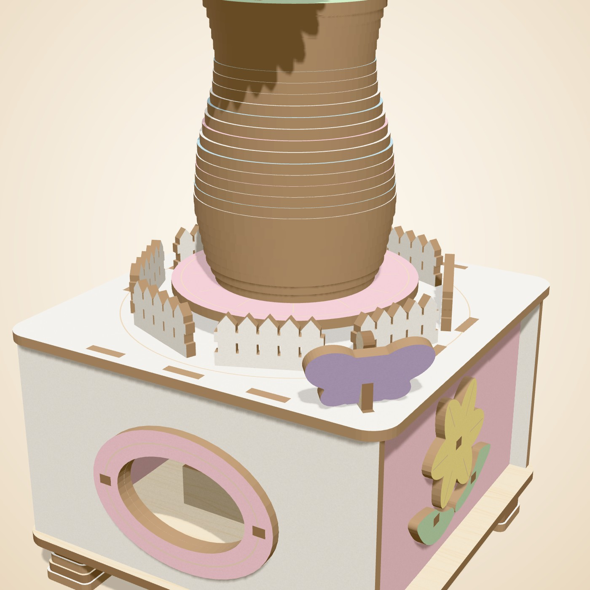

# Blossom Waltz

_A flower music box that turns while it plays._

Wind the key and the bouquet starts to dance. Blossom Waltz is a pastel garden in a box: eight layered flowers in a striped vase turn slowly on a little stage while a real wind-up movement plays. Every petal is cut from colored wood, with veins drawn by the laser. Build it in an evening, give it to someone, and watch them wind it again and again.

## At a glance

| Item | Value |
|---|---|
| Pieces (wood) | 156 (106 different shapes) |
| Build steps | 25 |
| Difficulty | 3 of 5, about 4 to 5 h |
| Sheets | 8 cut sheets = 4.5 full 12 x 12 in sheet equivalents (1 green, 1 natural, 1 pink, 1 purple, 1 teal, 2 white, 1 yellow) |
| Laser time per kit | 19.0 min cutting + 1.7 min sheet swaps = **20.7 min** (Estimate, planning speeds) |
| Wood cost per kit | **$13.20** (Estimate, sheet prices in `engine/hartwood/config.py`) |
| Target price | $49.99 |
| Extras in the box | 18-note wind-up music movement with rotating shaft x1; 3/16 in birch dowel, 55 mm x1; wax stick x1; sandpaper 240 grit x1 |

## Design checks

| Check | Result |
|---|---|
| Collision check | PASS: zero overlaps |
| Nothing-floats check | PASS: every part touches another; model is one piece |
| Assembly path check | PASS: every part slides into place without hitting a placed part |
| Minimum feature check | PASS: no feature thinner than 2.5 mm |

Fragile-part report: 2 small or thin parts, each cut with a spare: vase_key0, vase_key1.

Mechanism parts marked **needs physical test**: A10, A11, A12, A17, A18, A19, A9, D8.

## Sheets

| Sheet | Color | Size | Parts | Spares | Used | Laser min |
|---|---|---|---|---|---|---|
| A | natural | half | 43 | 0 | 55.3% | 3.1 |
| B | white | full | 30 | 0 | 59.2% | 4.6 |
| C | white | half | 14 | 0 | 28.7% | 1.9 |
| D | pink | full | 18 | 0 | 39.2% | 3.1 |
| E | green | half | 19 | 0 | 24.2% | 2.6 |
| F | yellow | quarter | 7 | 0 | 21.3% | 1.0 |
| G | teal | half | 10 | 0 | 30.6% | 1.7 |
| H | purple | quarter | 15 | 0 | 12.7% | 1.0 |

Half and quarter tiles are cut 2 or 4 at a time on one 12 x 12 sheet (files ending `_x2_full` or `_x4_full`).

## Files

- `cutfiles/`: one SVG, DXF and LightBurn file per sheet, plus `*_job*_bed` files that put two sheets on the 710 x 360 mm bed.
- `parts_map/`: a picture of each sheet with every part code (for the booklet and for packing).
- `parts/`: one picture per part code (106 images).
- `floral.glb`: the 3D model for the instruction app (one node per part).
- `floral_steps.json`: steps, parts per step, tips and tests.
- `floral_report.json`: the full build report.

## Renders

