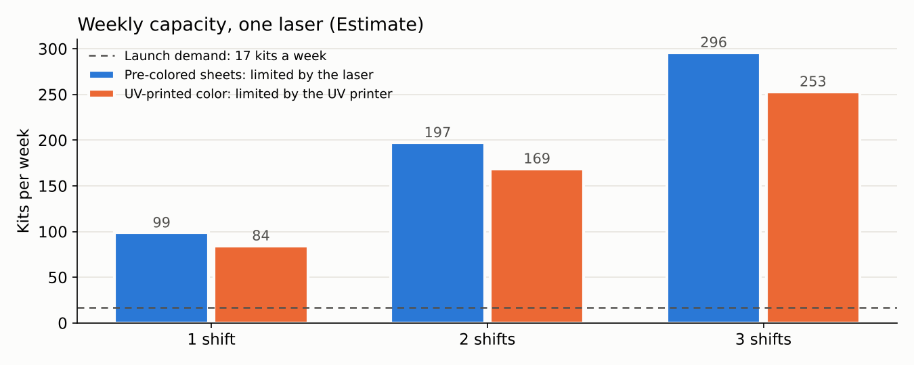
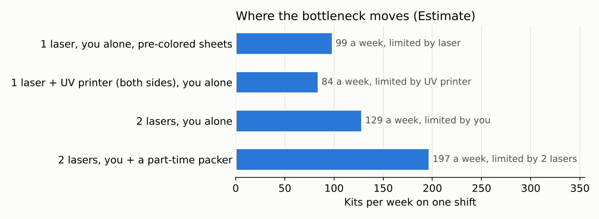
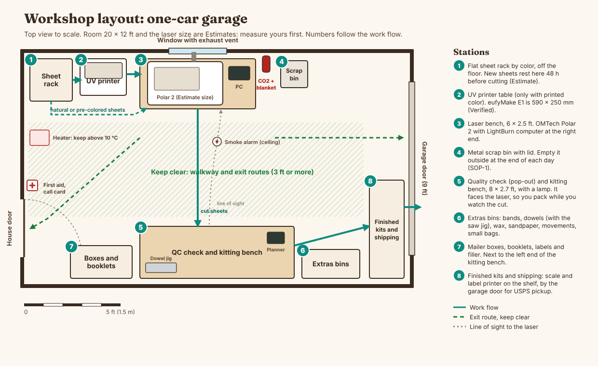

# Production system

Everything needed to run the workshop: how many kits it can make, a planner for the tablet, seven picture SOPs, the shop layout, and the quality loop.

| What | Open | Made by |
|---|---|---|
| Capacity model (1, 2 and 3 shifts, bottleneck) | [capacity.md](capacity.md) | `tools/make_capacity.py` |
| Workshop planner (tablet web app, works offline) | [planner/index.html](planner/index.html) | data from `tools/make_planner_data.py` |
| Seven visual SOPs (print and hang at each station) | [sops/index.html](sops/index.html) | `tools/make_sops.py` |
| Workshop layout (one-car garage, to scale) | [layout/workshop_layout.png](layout/workshop_layout.png) | `tools/make_layout.py` |
| Quality loop with Pareto | [quality_loop.md](quality_loop.md) | `tools/make_quality.py` |
| Quality change log | [quality/change_log.md](quality/change_log.md) | by hand |

## Capacity in one line

Takt time at launch (17 kits a week, one cutting day) is 28 min per kit; the laser needs 24. On one 8-hour shift, one laser and you make about **99 kits a week** with pre-colored sheets (the laser is the bottleneck), or about **85** with UV-printed color on both sides (the printer is the bottleneck). Add a second laser and **you** become the bottleneck at about 129 a week, until a part-time packer helps. All Estimates until the coupon and speed ladder are cut. Details: [capacity.md](capacity.md).

## The planner

Open `production/planner/index.html` on the tablet (Chrome or Safari). Add it to the home screen. Everything is saved on the tablet; export a backup every week (Settings).

| Tab | What it does |
|---|---|
| Orders | Type an order or import a CSV from your shop (`order_id, date, kit, qty, customer, channel`). |
| Cut queue | Groups waiting kits into batches. Lists each laser job file and how many runs. Half and quarter color sheets serve 2 or 4 kits per run. |
| Schedule | Lays the batch's laser jobs on a timeline for your shift (start time and hours in Settings). **Print the schedule** gives a paper list with a tick box per laser run. |
| Tracking | A board per kit: Waiting, Cut, Checked, Packed, Shipped. Tap to move a kit on. Packing takes extras out of stock. |
| Inventory | On-hand stock, reorder points from `supply/reorder_points.csv`, two suppliers per item. A red badge counts items to reorder. |
| Quality | Log problems by kit, part code and type. A Pareto chart for the last 4 weeks shows what to fix first. **Add the top bar** starts a design-change entry for it, and you tap its status from Open to Testing to Done (or Undone). |

Tests: `node tools/test_planner.js`.

## The SOPs

| SOP | Station | When |
|---|---|---|
| [SOP-1 Start-up and shut-down](sops/SOP-1_startup_shutdown.pdf) | Laser | Every day you cut |
| [SOP-2 Load and cut a job](sops/SOP-2_load_and_cut.pdf) | Laser | Every job (includes Print and Cut) |
| [SOP-3 Unload and pop-out check](sops/SOP-3_unload_and_popout.pdf) | Laser and bench | Every job |
| [SOP-4 Kitting and packing](sops/SOP-4_kitting_and_packing.pdf) | Packing bench | Every kit |
| [SOP-5 Weekly maintenance and calibration](sops/SOP-5_weekly_maintenance.pdf) | Laser | Every Friday (page 2 is the log) |
| [SOP-6 Fire and emergency](sops/SOP-6_fire_and_emergency.pdf) | Wall by the laser | Read before first use, practice it |
| [SOP-7 Shipping](sops/SOP-7_shipping.pdf) | Packing bench | Every packed kit, once a day |

Each SOP is one printed page (SOP-5 has a second page for the weekly log). The HTML versions reflow for the tablet.

## A normal week (Estimate, launch volume of 17 kits)

| Day | Work |
|---|---|
| Monday | Import orders, start a batch, check stock and reorder alerts. |
| Tuesday | Cut day: SOP-1, then SOP-2 and SOP-3 for each job. Pack (SOP-4) at the bench while the next job cuts. About 1 shift. |
| Wednesday to Thursday | Ship, answer customers, website and new designs. |
| Friday | SOP-5 maintenance and the coupon, then the 15-minute quality review. |

## Workshop layout

The packing bench faces the laser, so packing never means leaving the laser alone. The walkway to both doors stays clear. Measure the garage and the laser before building benches: the room size and the laser footprint are Estimates (the Polar 2's outside size was not published in any source found).
