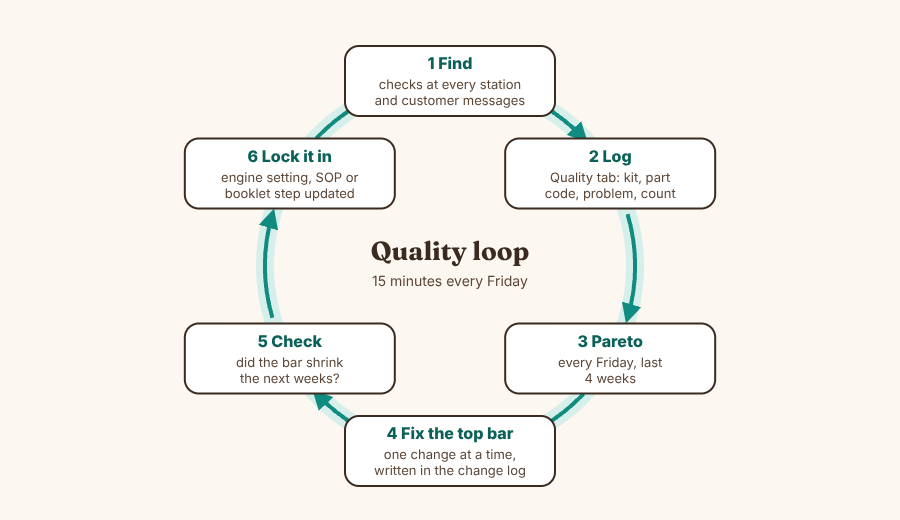
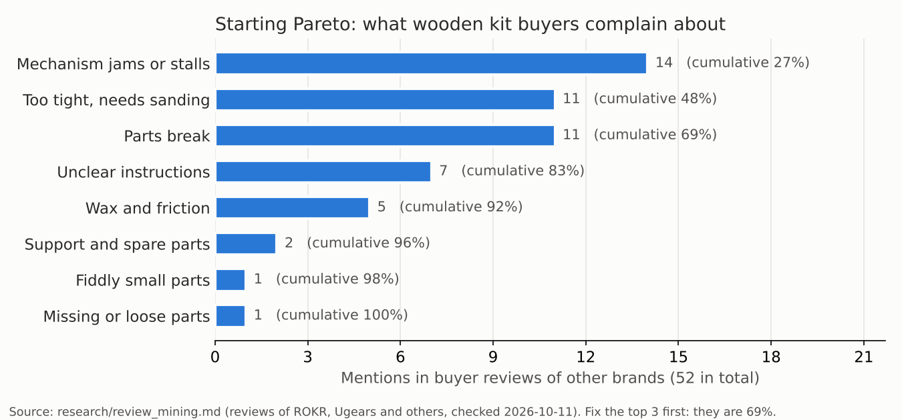

# Quality loop

How Hartwood finds problems, counts them, and fixes the biggest one first. It takes 15 minutes every Friday.

## 1. Where problems are found

Every station has a check. A problem found early costs a sheet. A problem found by a customer costs a sheet, postage and a review.

| # | Checkpoint | Where | What you check | SOP |
|---|---|---|---|---|
| Q1 | Incoming wood | Sheet rack | Flat (gap under a ruler 1 mm or less, Estimate), right color, no cracks or voids | SOP-2 step 2 |
| Q2 | Before lifting the sheet | Laser | A corner part moves when pressed. If not, recut while the sheet is still in place | SOP-3 steps 1 to 2 |
| Q3 | Pop-out check | Bench | Light through every cut line, bridges only at the green dots, first sheet of each batch pop-tested | SOP-3 steps 3 to 6 |
| Q4 | Show faces | Bench | No dark scorch on visible parts | SOP-3 step 8 |
| Q5 | Kit complete | Packing | Every sheet letter, extras counted twice, box weight within 5% of the first good box (Estimate) | SOP-4 steps 2 to 5 |
| Q6 | Mechanism | Test build | First 3 kits of a new design or a new wood lot: build the mechanism and run the test plan | `kits/blaster/mechanism_test_plan.md` |
| Q7 | Customer | Email, reviews, spare part requests | Every message that names a problem, and every spare part sent | Contact page |

## 2. Log every problem

Use the **Quality tab** in the planner (`production/planner/index.html`). One line per problem: kit, part code (if any), problem type, count and a short note. Spare part requests count too: the part code tells you exactly which part fails.

The problem types match the list below, so the chart groups them the same way every week.

| Problem type | What it looks like | Most likely cause | Try first |
|---|---|---|---|
| Mechanism does not work | Wheel, trigger, jaw, lid or music stalls or jams | Spin fit too tight, no wax, bent dowel | Raise `FIT['spin']` by 0.05 in `engine/hartwood/config.py`; check the wax step in the booklet; run the mechanism test plan |
| Part too tight or too loose | Needs force or sanding, or falls apart | Kerf changed with a new wood lot or a dirty lens | Cut the coupon (SOP-5), set `KERF`, run `tools/rebuild_all.sh` |
| Part broke | Snaps while popping out or building | Bridge too strong, thin feature, weak ply core | Coupon bridge tags (`BRIDGE`), check the pop-out direction in the booklet, try another wood supplier |
| Instructions unclear | Customer asks how a step works | Step image hides the part, or two moves in one step | Split the step in `engine/kits/<kit>.py`, rebuild the booklet and app (they share the same steps) |
| Part or extra missing | Customer is missing something | Count or weigh check skipped | Re-train SOP-4 steps 3 and 5; add the item to the kit card |
| Not cut through | Part stuck in the sheet | Dirty lens, focus, low power, warped sheet | SOP-5 optics, focus, then raise power 5% |
| Bridge too strong or part fell out | Needs a knife, or parts drop in the box | Kerf wider or narrower than planned | Coupon bridge tags; set `BRIDGE` to the tag that pops with a thumb |
| Burn marks | Dark stain on a show face | Slow speed, air assist off, dirty honeycomb (flash-back) | Check air assist, clean the honeycomb, raise speed 10% |
| Warped sheet | Gap under the ruler | Damp storage, poor lot | Store flat and warm; reject the lot with the supplier |
| Wrong color or print misaligned | Wrong tile, or print and cut do not line up | Wrong sheet loaded, Print and Cut targets set badly | Check the job name against the sheet; redo the two targets (SOP-2) |
| Packing or shipping damage | Broken parts in a crushed box | No filler, thin box | More filler; test drop one packed box from 1 m (Estimate) |

## 3. Pareto every Friday

Open the Quality tab. The chart sorts problem types from most to least, for the last 4 weeks. The tallest bar is the one to fix. Usually the top 2 or 3 bars are most of all problems.

Before you have your own data, start with what buyers of other wooden kits complain about. This is real data from review mining (`research/review_mining.md`, 52 complaints in reviews of ROKR, Ugears and others).

The top 3 (mechanism, tight fit, breakage) are 69% of complaints, and they share one cause: fit. That is why every Hartwood joint size comes from the coupon, and why the engine checks fit, pop-out and the assembly path before any file is cut.

## 4. Fix the top bar, one change at a time

1. In the planner's Quality tab, press **Add the top bar**. It fills in the problem, the kit and the part code that show up most. Write what you change and what you expect. (Or use `production/quality/change_log.md` on paper.)
2. Change **one** thing. If you change two, you will not know which one worked.
3. If the fix is a setting or a design change, make it in the engine and rebuild. Never edit a cut file by hand: the next rebuild would undo it.

## 5. Check it worked

Look at the same bar for the next 2 to 4 weeks. Tap the change's status: **Done** if the bar shrank, **Undone** if it did not (then try the next likely cause from the table).

## 6. Lock it in

A fix only sticks when it is written down where people look:
- a setting in `engine/hartwood/config.py` (kerf, fits, bridges, speeds), then `tools/rebuild_all.sh`;
- a step in an SOP (`tools/make_sops.py`, then rerun it);
- a booklet or app step (edit the kit, rebuild).

## Targets (Estimate, adjust after the first 3 months)

| Measure | How to count | Target |
|---|---|---|
| First-pass yield | Sheets cut without any problem / sheets cut | 98% or better |
| Customer problems | Problems logged from customers per 100 kits shipped | Under 3 |
| Spare parts sent | Per 100 kits shipped | Under 5 |
| Mechanism test | New design or new wood lot: 3 of 3 test kits pass | 100% before selling |

## Spare parts: free, fast, and a free source of data

Buyers of other brands complain that support is slow and spare parts cost postage. Hartwood sends spare parts free (TODO_LUCAS: confirm this policy).
1. The customer sends the kit name and the part code (printed on the part and in the booklet parts map).
2. Find the sheet letter from the code. Open that sheet's file in `kits/<kit>/cutfiles/`, delete every other part, and cut it from an offcut of the same color.
3. Mail it in a padded envelope. Log it on the Quality tab with the part code.

Many small parts already have a spare on the sheet (code ending in `s`): 57 on the Star Slinger, 6 on the Emberwing, none on Blossom Waltz yet.
