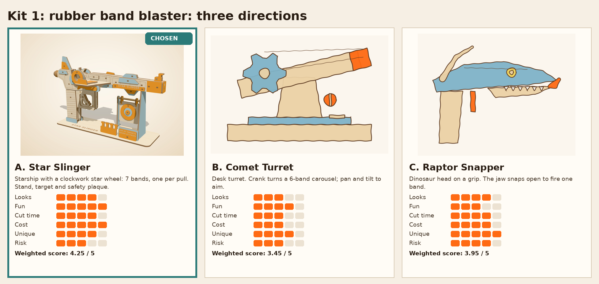
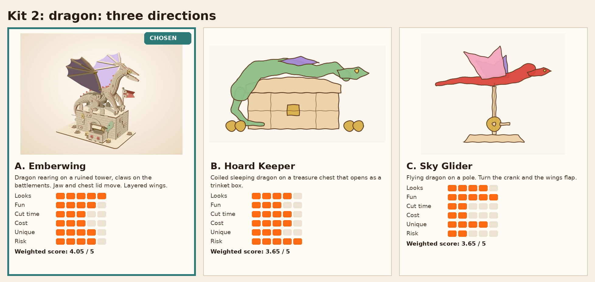
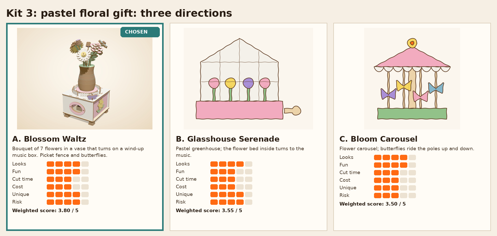

# Concept directions

Three directions per kit, scored 1 to 5 (5 = best; for Cut time, Cost and Risk 5 means fastest, cheapest, lowest risk). Weights: Looks 25%, Fun 25%, Unique 20%, Cut time 10%, Cost 10%, Risk 10%. Scores are my judgment (Estimate), using the review rules in `research/review_mining.md` and the white-space map in the research dashboard. Runner-up sketches are kept here so they can be built later.

## Kit 1: rubber band blaster

| Direction | Looks | Fun | Cut time | Cost | Unique | Risk | Weighted | Verdict |
|---|---|---|---|---|---|---|---|---|
| A. Star Slinger: Starship with a clockwork star wheel: 7 bands, one per pull. Stand, target and safety plaque. | 4 | 5 | 4 | 5 | 4 | 3 | 4.25 | CHOSEN: Most fun per dollar: 7 shots, a mechanism you can see working, and it reads as a spaceship, not a gun. |
| B. Comet Turret: Desk turret. Crank turns a 6-band carousel; pan and tilt to aim. | 3 | 4 | 3 | 3 | 4 | 3 | 3.45 | Runner-up: Fun on a desk, but more parts for the pan, tilt and carousel (cost and cut time up). Less to hold. |
| C. Raptor Snapper: Dinosaur head on a grip. The jaw snaps open to fire one band. | 4 | 3 | 4 | 4 | 5 | 4 | 3.95 | Runner-up: Very original and simple, but one shot per load gets boring fast (review rule H1: play value). |

## Kit 2: dragon

| Direction | Looks | Fun | Cut time | Cost | Unique | Risk | Weighted | Verdict |
|---|---|---|---|---|---|---|---|---|
| A. Emberwing: Dragon rearing on a ruined tower, claws on the battlements. Jaw and chest lid move. Layered wings. | 5 | 4 | 3 | 3 | 4 | 4 | 4.05 | CHOSEN: Strongest silhouette on a shelf; two simple moving parts; the tower gives a story and a base. |
| B. Hoard Keeper: Coiled sleeping dragon on a treasure chest that opens as a trinket box. | 4 | 3 | 4 | 4 | 3 | 5 | 3.65 | Runner-up: Useful as a box and easy to cut, but dragon-on-chest boxes already exist and it hides the wings. |
| C. Sky Glider: Flying dragon on a pole. Turn the crank and the wings flap. | 4 | 5 | 2 | 2 | 4 | 2 | 3.65 | Runner-up: Flapping is great fun, but the crank linkage adds parts, cut time and the top review complaint (mechanism). |

## Kit 3: pastel floral gift

| Direction | Looks | Fun | Cut time | Cost | Unique | Risk | Weighted | Verdict |
|---|---|---|---|---|---|---|---|---|
| A. Blossom Waltz: Bouquet of 7 flowers in a vase that turns on a wind-up music box. Picket fence and butterflies. | 4 | 4 | 3 | 3 | 4 | 4 | 3.80 | CHOSEN: Flowers that never wilt plus music: the clearest gift. Nearly empty space in the market map. |
| B. Glasshouse Serenade: Pastel greenhouse; the flower bed inside turns to the music. | 4 | 3 | 3 | 3 | 4 | 4 | 3.55 | Runner-up: Charming, but the glass panes would be open frames: fragile thin bars and flowers hidden inside. |
| C. Bloom Carousel: Flower carousel; butterflies ride the poles up and down. | 4 | 4 | 3 | 3 | 3 | 3 | 3.50 | Runner-up: Up-and-down riders need a cam ring (more risk); carousels are already a big ROKR/Robotime line. |

