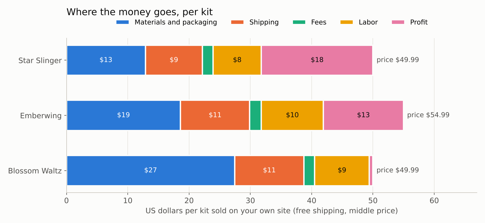
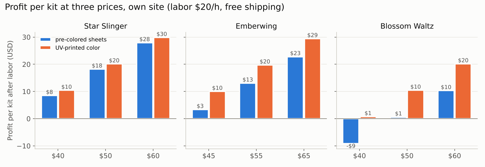

# Supply: materials, suppliers, costs

Generated by `tools/make_supply.py` from the kit build reports. Prices are **Verified** (seen in a search summary on 2026-10-12, search log S21) or **Estimate**. Change a number in `ITEMS` and rerun.

## Files

| File | What is in it |
|---|---|
| `bom_per_kit.csv` | Every item per kit: quantity, unit cost, cost per kit, price status |
| `bom_batches.csv` | What to buy for 25 and for 100 kits of each design, in whole packs |
| `suppliers.csv` | 2 or more suppliers per item, with the price seen and lead time |
| `reorder_points.csv` | Reorder level and order size per item at the launch plan (about 17 kits a week) |
| `startup_shopping_list.csv` | Everything to buy once to start |
| `unit_economics.csv` | Profit per kit at 3 prices x 2 channels x 2 color methods |
| `legal_checklist.md` | Must-do legal steps, with sources |

## Cost per kit (materials and packaging, before shipping)

| Kit | Pre-colored sheets | UV-printed color | Biggest items |
|---|---|---|---|
| Star Slinger | $12.87 | $9.50 | wood, booklet $3.61, box $1.83 |
| Emberwing | $18.60 | $10.79 | wood, booklet, box |
| Blossom Waltz | $27.45 | $13.34 | colored wood, music movement $3.00 (Estimate), booklet |

## Profit per kit on your own site (free shipping, labor $20/h)

| Kit | Price | Pre-colored sheets | UV-printed color |
|---|---|---|---|
| Star Slinger | $39.99 | $8.50 (21%) | $10.40 (26%) |
| Star Slinger | $49.99 | $18.21 (36%) | $20.11 (40%) |
| Star Slinger | $59.99 | $27.92 (47%) | $29.82 (50%) |
| Emberwing | $44.99 | $3.35 (7%) | $10.00 (22%) |
| Emberwing | $54.99 | $13.06 (24%) | $19.71 (36%) |
| Emberwing | $64.99 | $22.77 (35%) | $29.42 (45%) |
| Blossom Waltz | $39.99 | -$9.12 (-23%) | $0.73 (2%) |
| Blossom Waltz | $49.99 | $0.59 (1%) | $10.44 (21%) |
| Blossom Waltz | $59.99 | $10.30 (17%) | $20.15 (34%) |

Etsy costs about $3 more per kit in fees (6.5% + 3% + $0.25 + $0.20 listing) than Shopify (2.9% + $0.30). See the CSV for every row.

## What this means

- **Star Slinger** is healthy at $49.99 either way.
- **Emberwing** needs $54.99 or more. UV-printed color helps a lot (24% to 36% margin at $54.99).
- **Blossom Waltz** only works at $59.99 with pre-colored sheets, or at $49.99 with UV-printed color. It uses six colors.
- **Booklets** ($3.61 each, Estimate) are the second-biggest cost. Cheaper options: print in-house (about $1.50), or a 4-page quick-start card plus the 3D app and PDF.
- **Shipping** is $9 to $11 per kit with free shipping (USPS Ground Advantage, 2 to 3 lb).

## Startup budget

- Required: **$7,518**: laser, safety, tools, LLC, first-year insurance, and starter materials for 25 of each kit.
- Recommended: **$1,759**: UV printer and ink (see `research/color_printing.md`).
- Optional: **$1,150**: fume extractor (only if you cannot vent outside), booklet printer.

Box size check (TODO_LUCAS): the stock 12 x 12 x 2 in mailer only fits if your sheets measure 12 in or less. Measure a pack. Otherwise trim the sheets on the laser or order a 12.5 in custom box.
